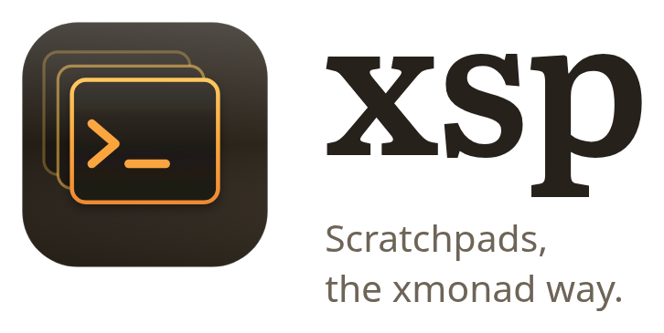

<p align="center">
  <picture>
    <source media="(prefers-color-scheme: dark)" srcset="docs/xsp-header-dark.png">
    
  </picture>
</p>

<p align="center">
xmonad's exclusive scratchpads for macOS 27: three Alacritty terminals on F1, F3
and F4.
</p>

<p align="center">
  <a href="https://crazyboycjr.github.io/xsp/">Homepage</a> ·
  <a href="#keys">Keys</a> ·
  <a href="#how-it-works">How it works</a> ·
  <a href="#install">Install</a> ·
  <a href="#command-line">Command line</a> ·
  <a href="#limits">Limits</a> ·
  <a href="CHANGELOG.md">Changes</a>
</p>

<picture>
  <source media="(max-width: 600px) and (prefers-color-scheme: dark)" srcset="docs/readme-pads-tall-dark.svg">
  <source media="(max-width: 600px)" srcset="docs/readme-pads-tall-light.svg">
  <source media="(prefers-color-scheme: dark)" srcset="docs/readme-pads-dark.svg">
  
</picture>

## Why I created this

On Linux, [xmonad](https://xmonad.org/) gives me three scratchpad terminals on
F1, F3 and F4. A key brings one up over whatever I am doing, the same key puts
it away, and only one is out at a time. I use them constantly, and on the Mac I
wanted exactly that: the same keys, the same behaviour, in
[Alacritty](https://alacritty.org/). The usual Mac answer is a hotkey window
like iTerm2's, but that ties the pads to iTerm2, and I wanted Alacritty with
xmonad's keys and behaviour.

The keys were the easy part. macOS 27 gives every ordinary app a place in the
Dock and the app switcher, won't let one app hide another app that stays out of
the Dock, and shows a window on whichever desktop it was left on rather than the
one you are looking at. xsp works around each of these, and uses
[ZeroSpace](https://github.com/crazyboycjr/zerospace), my instant desktop
switcher, to bring a pad to the current desktop. Like ZeroSpace, I built it with
an AI coding agent, Claude.

If you miss xmonad's scratchpads on a Mac, read on.

## What it is

xsp is a small Rust program that runs as a login agent and keeps three
scratchpads, pads for short, one key away. Each pad is Alacritty with your usual
configuration, titled scratch-0, scratch-1 and scratch-2.

- **One at a time.** Bringing up another pad puts the first away, as xmonad's
  exclusive scratchpads do.
- **Here, not there.** A pad comes to the desktop you are on, through ZeroSpace,
  rather than taking you to the desktop it was left on.
- **Out of the way.** The pads have no Dock icon and no place in the app
  switcher, and a pad steps aside when you switch to another app.
- **Over everything.** A pad covers the whole screen, menu bar included, and
  comes and goes without an animation.

## Keys

<kbd>f1</kbd> brings up scratch-0, <kbd>f3</kbd> scratch-1 and <kbd>f4</kbd>
scratch-2. The keys are Carbon hot keys, so the app in front never sees them,
and xsp installs no event tap. On an Apple keyboard the top row works the
brightness and the like until you turn on "Use F1, F2, etc. keys as standard
function keys" in System Settings, Keyboard, Keyboard Shortcuts, Function Keys;
until then, hold <kbd>fn</kbd> with the key.

Each key behaves the way xmonad's `ExclusiveScratchpads` do, with one rule added
for the Mac: switching to another app puts the pad away.

| When you | xsp |
| :--- | :--- |
| press a pad's key for the first time | starts the pad, which comes up in front with the keyboard |
| press the key of the pad that is out | puts it away and gives the keyboard back to the app you were in |
| press the key of a pad that is away, hidden or still out on another desktop | brings it to the desktop you are on, in front, with ZeroSpace running |
| press another pad's key | brings that pad up and puts the first away, so only one is out on a desktop at a time |
| switch to another app on the same desktop, with <kbd>cmd</kbd>&nbsp;<kbd>tab</kbd>, a click or a switcher such as AltTab | puts the pad away, so the windows under it come forward |
| leave the desktop | keeps the pad out there, ready for when you come back |

## How it works

xsp runs as a login agent with no Dock icon. Each pad is Alacritty under its own
bundle id, `xyz.crazyboycjr.xsp.scratch-N`, in a small app that xsp keeps in
`~/Library/Application Support/xsp/`, so that macOS can hide, show and focus
exactly that pad. macOS 27 stands in the way three times:

- **Every ordinary app sits in the Dock and the app switcher.** Each pad's app
  is marked as an accessory app (`LSUIElement`), so it has neither. Editing an
  app's `Info.plist` does not change what LaunchServices knows about it, so xsp
  registers the app again (`lsregister -f`) whenever it prepares it.
- **One app cannot hide another app's accessory app.** The ordinary call,
  `NSRunningApplication`'s `hide`, refuses, so xsp hides a pad through
  Accessibility, setting `kAXHidden` the way cmd+H does, and shows it with a
  LaunchServices reopen, which unhides and activates it and needs no permission.
  Until Accessibility is granted, the pads stay ordinary Dock apps and hide the
  ordinary way, so nothing breaks before the grant comes.
- **A window shows on the desktop it was left on.** The window server keeps a
  hidden window's desktop, so before showing a pad, xsp asks ZeroSpace, through
  its socket, to move the pad's window to the desktop you are on. Without
  ZeroSpace, a pad that is out on another desktop stays there, and showing it
  switches to that desktop.

A pad covers the whole screen, menu bar strip included. Alacritty's own
SimpleFullscreen changes the presentation options and makes the menu bar animate
at every show, so the pads start windowed and undecorated instead, whatever the
Alacritty configuration says, with a small library, `xsp-overlay.dylib` (built
from `overlay.c`), loaded into them alone through `DYLD_INSERT_LIBRARIES`. It
raises the terminal window above the menu bar, sizes it to the screen and turns
off its show and hide animation, again whenever the window becomes key or moves
to another display. That works because the pads' apps are signed without the
hardened runtime.

Each pad's app holds a copy of Alacritty's binary rather than a link to it,
since LaunchServices follows a link and the process would then check in as
Alacritty itself. xsp refreshes the copies when Alacritty changes and signs them
again only then, each with the same identity and a fixed identifier, so that
once you sign with a certificate, each pad keeps the permissions you give it. A
running pad is never rewritten.

## Install

xsp is made for macOS 27, and has been tested on macOS 27.0.1 on Apple Silicon.
It needs Alacritty, which it finds in `/Applications` or `~/Applications`, where
Alacritty's release goes, or in `/Applications/Nix Apps`, where nix-darwin puts
it; for anywhere else, set `XSP_ALACRITTY` to the app's path when you build.
[ZeroSpace](https://github.com/crazyboycjr/zerospace) is optional: with it
running, a pad comes to the desktop you are on. Building takes Rust and the
Xcode Command Line Tools (`xcode-select --install`).

```sh
git clone https://github.com/crazyboycjr/xsp
cd xsp
sh build.sh
```

`build.sh` builds xsp and its overlay library, installs them as
`~/.local/bin/xsp` and `~/.local/bin/xsp-overlay.dylib`, writes the login agent
`xyz.crazyboycjr.xsp` to `~/Library/LaunchAgents`, and starts it. The first
start asks for Accessibility; allow it, and the pads leave the Dock from their
next start. The log is `~/Library/Logs/xsp.log`. `~/.local/bin` is not on
macOS's default path, so add it to your `PATH` to type `xsp` alone.

`XSP_OVERLAY=0 sh build.sh` leaves the menu bar overlay out of pads started
after that, and they open as your Alacritty configuration says, in its
SimpleFullscreen for example.

### Signing

`build.sh` signs ad hoc unless told otherwise, and xsp signs the pads' apps the
same way whenever Alacritty changes. That works, but an ad hoc signature changes
with every build, and macOS then forgets xsp's Accessibility grant and each
pad's own grants, such as access to your folders. A self-signed certificate
keeps them; the one you made for ZeroSpace will do:

1. Open Keychain Access from Spotlight; since macOS 15 it is no longer in
   Utilities. Choose Keychain Access, Certificate Assistant, Create a
   Certificate.
2. Name it, for example Local Code Signing, with Identity Type Self-Signed Root
   and Certificate Type Code Signing.
3. Build with it:

```sh
CODESIGN_IDENTITY="Local Code Signing" sh build.sh
```

Because xsp signs its pads itself, `build.sh` hands the setting on to the login
agent. The first signing asks whether codesign may use the key; choose Always
Allow, since the agent signs again later on its own. If xsp was built ad hoc
before, its old entry in System Settings, Privacy & Security, Accessibility
stays ticked but no longer counts: remove it with the minus button and allow xsp
again.

To keep the setting, put the line `CODESIGN_IDENTITY="Local Code Signing"` in
`signing.env` beside `build.sh`, which git ignores; `XSP_ALACRITTY` and
`XSP_OVERLAY` can go there too. Where the login keychain is locked, as over ssh,
keep the certificate in a keychain of its own, give the keychain's path in
`CODESIGN_KEYCHAIN` and its password in `CODESIGN_KEYCHAIN_PASSWORD`. The
agent's plist then holds that password in plain text; `build.sh` makes the file
readable only by you, but give that keychain nothing besides the certificate.

### Stop and remove

```sh
launchctl bootout gui/$(id -u)/xyz.crazyboycjr.xsp
rm ~/Library/LaunchAgents/xyz.crazyboycjr.xsp.plist
rm ~/.local/bin/xsp ~/.local/bin/xsp-overlay.dylib
rm -r ~/Library/Application\ Support/xsp
```

Then take xsp out of System Settings, Privacy & Security, Accessibility.

## Command line

The `xsp` command talks to the running agent through a Unix socket,
`~/.cache/xsp.sock`:

```sh
~/.local/bin/xsp toggle 0   # what F1 does; 1 is F3, 2 is F4
~/.local/bin/xsp status     # each pad's process, windows and desktop
```

The agent itself is `xsp daemon`, which the login agent runs.

## Limits

- xsp has only been tested on macOS 27.0.1 on Apple Silicon, with one display.
- There are three pads, on F1, F3 and F4, set in the source; to change them,
  edit `KEYS` in `src/main.rs` and build again.
- The pads are Alacritty and nothing else, and each keeps its own copy of it.
- xsp reads the current desktop, and each window's, through private calls to the
  window server, which a macOS update can change.
- Without ZeroSpace, a pad left out on another desktop takes you there when you
  show it.
- In a full-screen app, a pad on another desktop takes you there, since a window
  cannot be moved into a full-screen app.
- The overlay loads a library into the pads, which needs their apps signed
  without the hardened runtime.

## License

MIT; see [LICENSE](LICENSE). The picture in this README is an illustration,
drawn rather than recorded.
